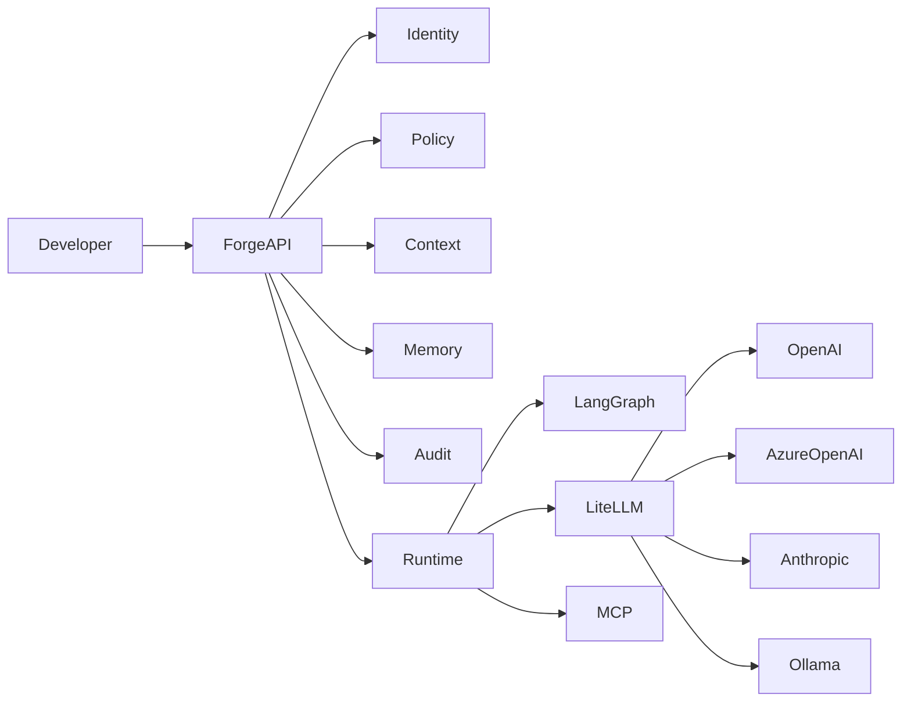
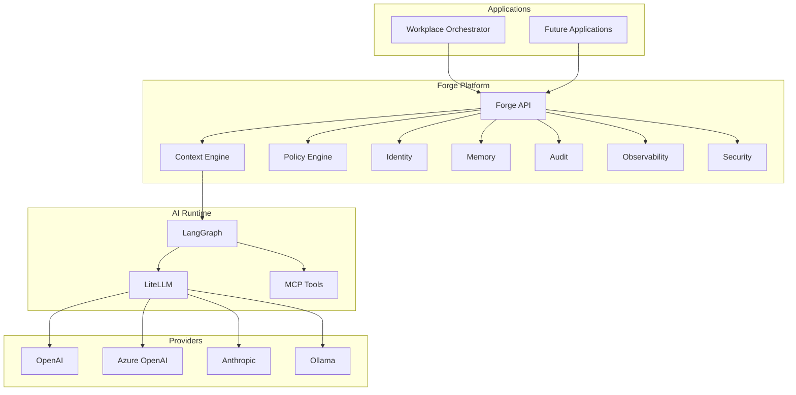
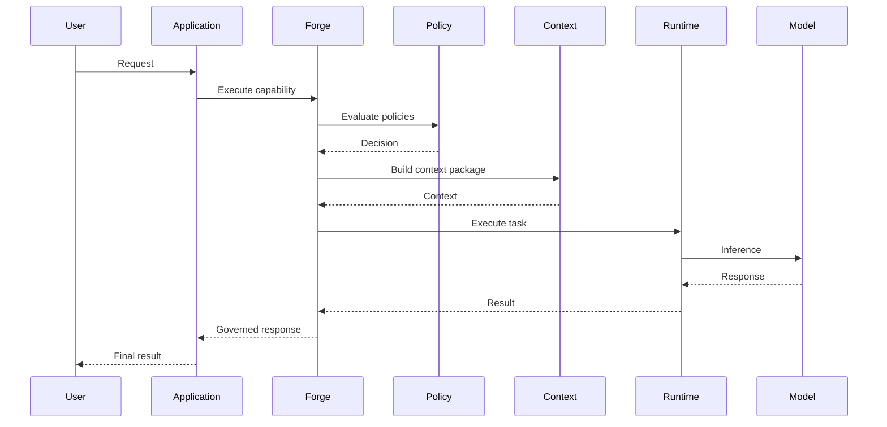
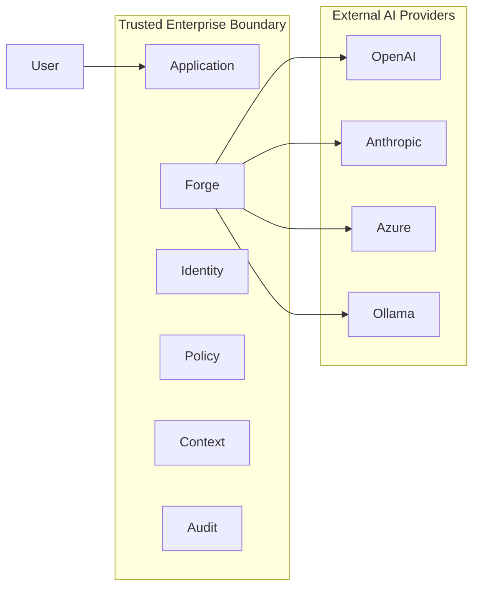
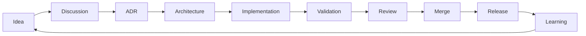
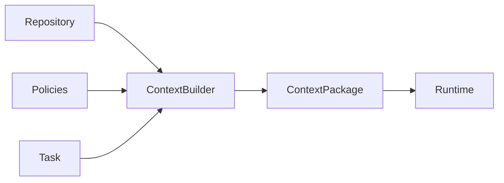
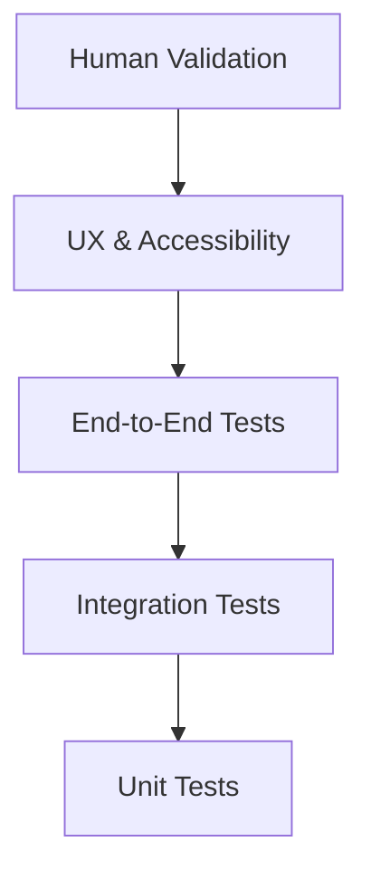
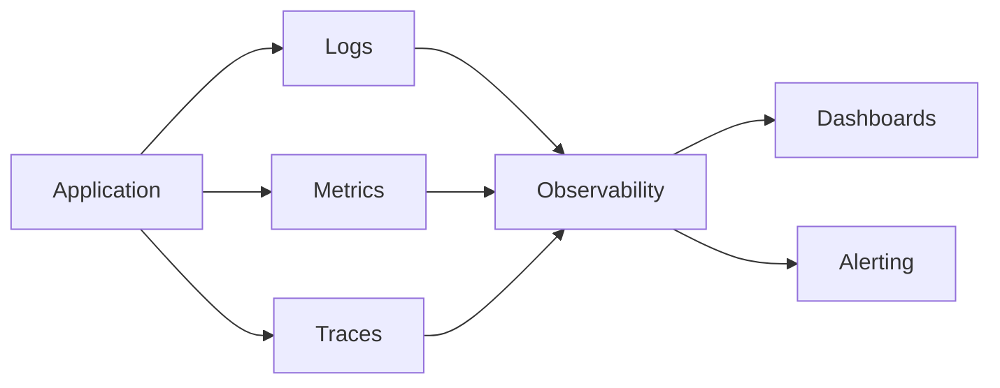
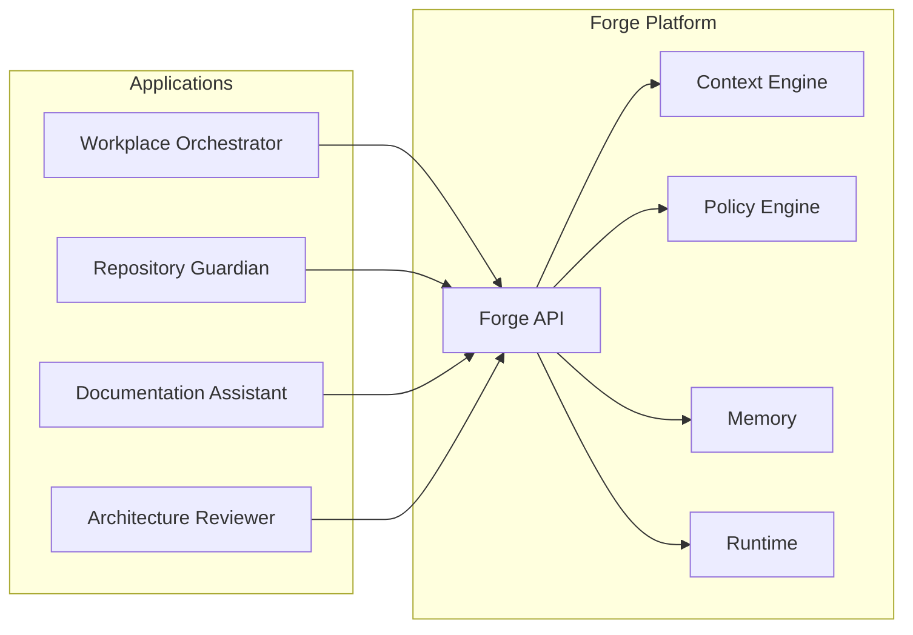

# Forge

> **Architecture consolidation in progress:** this document remains intact as source material for the proposed [Forge mega masterplan](docs/foundation/masterplan.md). No source content is removed during the first migration stage; see the [content migration map](docs/governance/content-migration.md).

> **An enterprise AI engineering platform for building trustworthy, governed and vendor-independent AI applications.**

---

# 1. Vision

Forge is an engineering platform that enables organizations to design, build, govern and operate enterprise AI solutions with the same engineering discipline applied to modern cloud-native software.

Rather than being another AI framework or orchestration library, Forge provides the foundational capabilities required to safely integrate Large Language Models (LLMs), traditional software, enterprise identity, governance and business processes into a coherent platform.

Forge treats AI as an engineering discipline instead of a collection of prompts.

---

# 2. Why Forge Exists

Most AI projects today begin with selecting a model and only afterwards consider architecture, governance, security and lifecycle management.

Forge reverses this order.

The platform starts with engineering principles:

- Governance before automation.
- Policy before execution.
- Context before prompting.
- Identity before access.
- Evidence before assumptions.
- Human accountability before autonomous action.

---

# 3. The Problem

Enterprise AI projects often suffer from one or more of the following issues:

- Tight coupling to a single model provider.
- Prompt engineering without architectural governance.
- Duplicate implementations of authentication, authorization and audit.
- Uncontrolled token consumption.
- Poor traceability.
- Limited test automation.
- No durable project memory.

Forge addresses these concerns through reusable platform capabilities instead of application-specific implementations.

---

# 4. What Forge Is

Forge is:

- An AI engineering platform.
- A governance platform.
- A context engineering platform.
- A policy-driven runtime.
- A reusable foundation for enterprise AI applications.

Applications such as **Workplace Orchestrator** consume Forge services rather than implementing these concerns themselves.

---

# 5. What Forge Is Not

Forge is **not**:

- Another LLM wrapper.
- A chatbot framework.
- A prompt library.
- A workflow engine.
- A replacement for LangGraph, LiteLLM or MCP.

Instead, Forge composes these technologies into a governed enterprise platform.

---

# 6. Design Goals

The primary goals of Forge are:

1. Vendor independence.
2. Security by design.
3. Privacy by design.
4. Policy-driven execution.
5. Context as Code.
6. Knowledge as Code.
7. Test by Design.
8. Accessibility by Design.
9. Economic Intelligence.
10. Human accountability.

---

# 7. High-Level Architecture



---
# 8. Core Platform Capabilities

Forge provides platform capabilities rather than application features. Every application built on Forge consumes these capabilities through well-defined interfaces.

| Capability | Purpose |
|------------|---------|
| Identity | Authentication and identity federation |
| Policy | Authorization and policy evaluation |
| Context Engineering | Build minimal, relevant AI context |
| Memory | Durable project and execution memory |
| Model Routing | Select the appropriate model based on capability and policy |
| Tool Orchestration | Execute MCP-compatible tools |
| Audit | End-to-end traceability |
| Observability | Metrics, logs and traces |
| Security | Platform-wide security controls |

Applications SHOULD reuse these services instead of implementing their own variants.

---

# 9. Architectural Layers



---

# 10. Request Lifecycle

Every AI request follows the same logical pipeline.



Key principles:

- Identity SHALL be established before execution.
- Policies SHALL be evaluated before model invocation.
- Context SHALL be minimized.
- Every execution SHALL be auditable.

---

# 11. Trust Boundaries

Forge explicitly separates trust domains.



Only the minimum required information SHOULD cross the enterprise boundary.

---

# 12. Design Principles for Components

Every platform component SHALL:

- Have a single primary responsibility.
- Expose stable interfaces.
- Be independently testable.
- Produce observable telemetry.
- Be replaceable without impacting consumers.
- Avoid direct dependency on model vendors.

---

# 13. Platform Extensibility

Forge is designed around capability composition rather than inheritance.

New capabilities SHOULD be added by extending the platform instead of modifying existing services.

Examples:

- Repository Guardian
- Architecture Reviewer
- Documentation Assistant
- Policy Advisor
- Test Automation Assistant

---

# 14. Repository as the Source of Truth

One of the fundamental design principles of Forge is that the repository is the durable source of engineering knowledge.

Conversations, meetings and whiteboard sessions are valuable during discovery, but they SHALL be transformed into version-controlled artefacts before they become part of the platform.

The repository therefore becomes the authoritative source for:

- Architecture
- Engineering decisions
- Policies
- Standards
- Project memory
- Development practices
- Test strategies
- AI governance

## Why this matters

Repository-first engineering provides:

- Traceability
- Version history
- Peer review
- Auditability
- Knowledge transfer
- AI-readable documentation

AI assistants SHALL treat the repository as the canonical knowledge base rather than relying on conversational memory.

---

# 15. Documentation Philosophy

Forge documentation is intentionally structured as an Engineering Handbook rather than a collection of unrelated documents.

Every document has a clear purpose.

| Document | Responsibility |
|----------|----------------|
| README | Executive overview and entry point |
| Constitution | Immutable engineering principles |
| Architecture | Technical architecture |
| ADRs | Record architectural decisions |
| Development | Engineering workflow |
| Quality | Testing and validation |
| Security | Security architecture |
| Governance | Policies and operational controls |

The documentation SHALL avoid duplication by referencing authoritative documents.

---

# 16. Engineering Workflow



Every significant engineering change SHOULD follow this lifecycle.

---

# 17. AI Governance

Forge does not delegate accountability to AI.

AI systems assist engineers.

Humans remain accountable for:

- Architecture
- Security
- Compliance
- Production approval
- Business decisions

AI MAY:

- Generate code
- Review documentation
- Suggest improvements
- Produce tests
- Explain behaviour

AI SHALL NOT become the authoritative decision maker.

---

# 18. Repository Structure

```text
forge/
├── docs/
│   ├── architecture/
│   ├── development/
│   ├── adr/
│   ├── security/
│   └── governance/
├── examples/
├── policies/
├── schemas/
├── tools/
├── tests/
└── applications/
```

This layout separates normative documentation, reference implementations and operational artefacts.

---

# 19. Knowledge as Code

Knowledge SHALL be managed using the same engineering discipline as source code.

Knowledge artefacts include:

- Markdown
- ADRs
- Policies
- Architecture diagrams
- JSON schemas
- OpenAPI specifications
- Mermaid diagrams

Every knowledge artefact SHOULD be reviewable, versioned and testable where practical.

---

# 20. Context as Code

Forge treats context as a managed engineering artefact.

Rather than constructing prompts ad hoc, applications assemble context packages from trusted sources.



Benefits include:

- Smaller prompts
- Better reproducibility
- Lower token consumption
- Improved auditability

---

# 21. Development Philosophy

Forge adopts software engineering practices that have proven themselves in large-scale enterprise systems and applies them to AI engineering.

## Engineering Principles

- Everything as Code
- Knowledge as Code
- Context as Code
- Policy as Code
- Architecture as Code
- Infrastructure as Code
- Test by Design
- Accessibility by Design
- Security by Design
- Observability by Default

The goal is deterministic engineering wherever practical.

---

# 22. Quality Engineering

Quality is not measured solely by the absence of defects.

Forge evaluates quality across multiple dimensions.

| Domain | Objective |
|---------|-----------|
| Functional | Correct behaviour |
| Security | Protection against threats |
| Privacy | Appropriate handling of data |
| Reliability | Predictable execution |
| Performance | Efficient resource usage |
| Accessibility | Inclusive user experience |
| Maintainability | Sustainable engineering |
| Observability | Measurable behaviour |
| AI Quality | Repeatable and explainable outcomes |

Every change SHOULD improve or preserve these quality attributes.

---

# 23. Continuous Validation

Forge extends traditional CI/CD into Continuous Validation.

```mermaid
flowchart LR

Code --> Build
Build --> StaticAnalysis
StaticAnalysis --> UnitTests
UnitTests --> IntegrationTests
IntegrationTests --> APIValidation
APIValidation --> Accessibility
Accessibility --> UXValidation
UXValidation --> Security
Security --> Performance
Performance --> HumanApproval
HumanApproval --> Release
```



Validation SHALL become increasingly automated over time.

---

# 24. Test Automation Strategy

The preferred testing pyramid extends beyond source code.



Recommended technologies include:

- Playwright
- axe-core
- Bruno
- Schemathesis
- Pact
- Trivy
- Semgrep
- k6
- OpenTelemetry

Technology choices remain replaceable.

---

# 25. Security by Design

Security is an architectural concern rather than a deployment concern.

Forge SHALL:

- authenticate identities;
- evaluate authorization policies;
- minimise data exposure;
- audit every execution;
- encrypt data in transit;
- support Zero Trust principles.

Security controls SHOULD be reusable platform capabilities.

---

# 26. Localization and Accessibility

English is the canonical engineering language.

User interfaces SHALL support localization without source code changes.

User-visible strings SHOULD be externalized into translation resources.

Forge targets WCAG 2.2 AA as the minimum accessibility baseline.

Accessibility includes:

- keyboard navigation;
- screen readers;
- sufficient contrast;
- captions where applicable;
- scalable layouts;
- reduced motion support.

---

# 27. Observability

Every platform capability SHOULD emit telemetry.



Observability supports:

- Operations
- Engineering
- Security
- Audit
- Capacity planning

---

---
title: Forge
subtitle: Enterprise AI Engineering Platform
document: README
part: 5
version: 0.1-draft
status: Draft
---

# 28. Technology Stack

Forge deliberately distinguishes between **platform capabilities** and **technology choices**. Technologies are implementation details and MAY be replaced provided they continue to satisfy the architectural requirements.

## Reference Technology Stack

| Layer | Preferred Technology | Purpose |
|--------|----------------------|---------|
| Programming Language | Go | Platform services |
| Web Frontend | React + TypeScript | User interfaces |
| API | REST / OpenAPI | Public interfaces |
| AI Runtime | LangGraph | Workflow orchestration |
| Model Gateway | LiteLLM | Provider abstraction |
| Tool Protocol | MCP | Standardized tool integration |
| Identity | OpenID Connect / OAuth2 | Authentication |
| Authorization | Open Policy Agent (OPA) | Policy evaluation |
| Observability | OpenTelemetry | Logs, metrics and traces |
| Documentation | Markdown + Mermaid | Engineering knowledge |
| Source Control | GitHub | Source of Truth |
| CI/CD | GitHub Actions | Automation |

No technology is considered irreplaceable.

---

# 29. Getting Started

The recommended onboarding path for engineers is:

1. Read this README.
2. Read the Engineering Constitution.
3. Review the System Overview.
4. Read the Architecture documentation.
5. Understand the repository structure.
6. Install the development environment.
7. Build the platform locally.
8. Execute the validation pipeline.
9. Review the ADRs.
10. Start contributing.

New contributors SHOULD understand the architectural principles before writing code.

---

# 30. Reference Applications

Forge is designed as a reusable platform supporting multiple applications.

Current and planned applications include:

- Workplace Orchestrator
- Repository Guardian
- Documentation Assistant
- Architecture Reviewer
- Policy Advisor
- Test Automation Assistant

Applications SHOULD consume platform capabilities through stable APIs rather than implementing their own infrastructure.



---

# 31. Roadmap

The roadmap evolves through Architecture Decision Records (ADRs) and iterative delivery.

The initial focus areas are:

- Core platform capabilities
- Repository Guardian
- Workplace Orchestrator
- Policy Engine
- Context Engine
- Memory Model
- AI Governance
- Continuous Validation
- OpenTelemetry integration

Future work is prioritized according to architectural value rather than feature count.

---

# 32. Contributing

Forge welcomes contributions that improve:

- Architecture
- Documentation
- Platform capabilities
- Testing
- Security
- Accessibility
- Developer experience

Every contribution SHOULD:

- follow the Engineering Constitution;
- reference relevant ADRs where appropriate;
- include tests where practical;
- preserve architectural consistency.

---

# 33. Community

Forge is intended as an engineering platform for organizations that require trustworthy, governed and maintainable AI systems.

The community is expected to value:

- engineering excellence;
- open standards;
- interoperability;
- transparency;
- continuous learning.

Constructive architectural discussions are encouraged. Decisions should be documented rather than remembered.

---

# 34. Closing Principles

Forge is founded on a simple premise:

Enterprise AI deserves the same engineering discipline as every other critical software platform.

Artificial intelligence should enhance human capability, not replace engineering judgement.

By treating architecture, governance, context, security and knowledge as first-class engineering artefacts, Forge provides a foundation for sustainable enterprise AI systems.

The repository is the source of truth.

Engineering decisions are explicit.

Policies are executable.

Context is intentional.

Knowledge is durable.

People remain accountable.

---

_End of README.md_

The remaining documents in the Engineering Handbook expand on the concepts introduced here and serve as the normative reference for implementing, operating and evolving the Forge platform.


