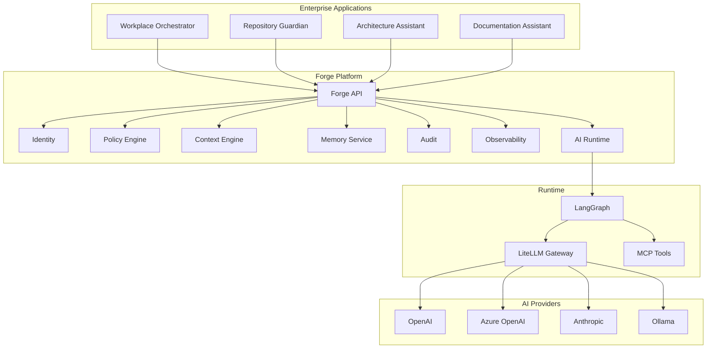
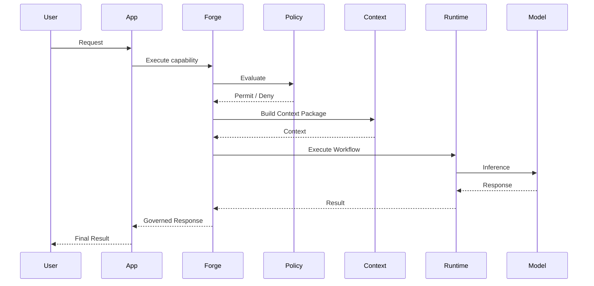
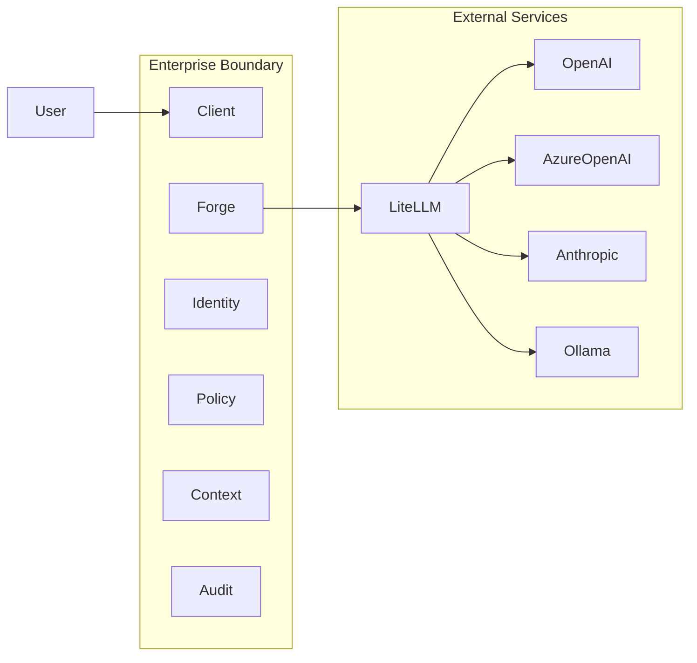
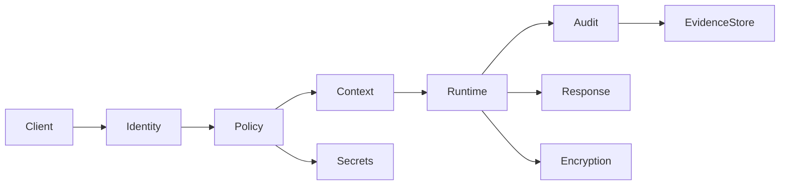
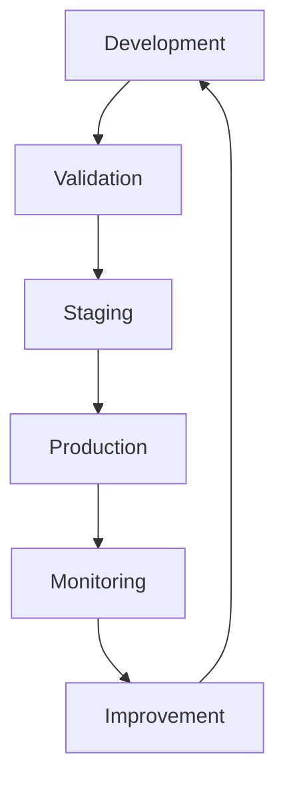
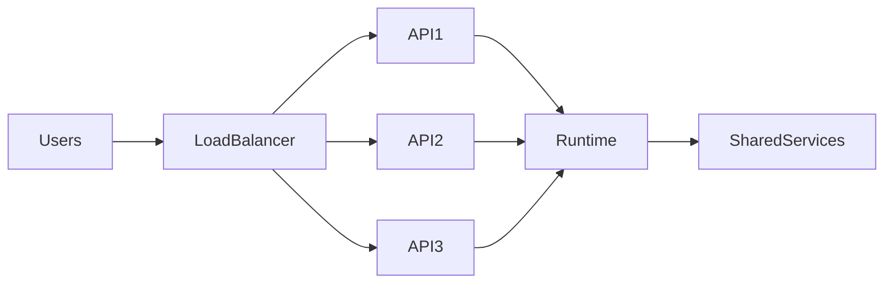
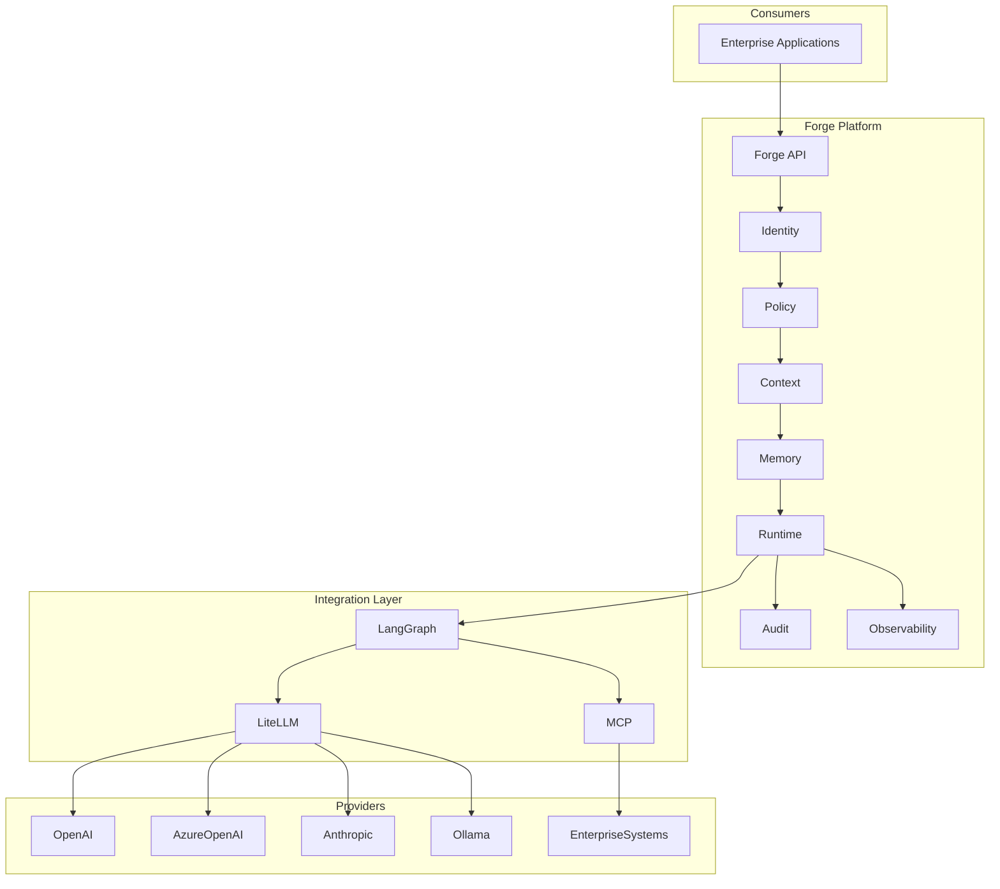

# System Overview

> This document provides the high-level reference architecture for the Forge platform.

## Purpose

The System Overview describes the major architectural building blocks of Forge, their relationships and the responsibilities of each capability.

Detailed implementation guidance is provided in the Architecture, Policy, Context Engineering and Memory Model documents.

---

# 1. Architectural Vision

Forge is a platform that enables multiple AI-powered enterprise applications to share a common set of governed platform capabilities.

Applications remain intentionally thin.

Platform capabilities remain reusable.

---

# 2. Capability Model

Forge separates **business capabilities** from **technical implementation**.

| Capability | Responsibility |
|------------|----------------|
| Identity | Authenticate users and services |
| Policy | Evaluate authorization and governance |
| Context | Assemble deterministic context packages |
| Memory | Persist durable engineering knowledge |
| Runtime | Execute orchestrated AI workflows |
| Audit | Produce evidence of execution |
| Observability | Expose logs, metrics and traces |

Each capability has a single primary responsibility.

---

# 3. Request Lifecycle

Every request traverses the same logical execution path.

Execution SHALL remain deterministic wherever practical.

---

# 4. Trust Boundaries

Only the minimum required context SHOULD leave the enterprise boundary.

---

# 5. Guiding Characteristics

The platform is designed to be:

- Vendor independent
- Policy driven
- Observable
- Secure by Design
- Privacy by Design
- Context aware
- Testable
- Replaceable
- Evolvable

---

# System Overview

> This document provides the high-level reference architecture for the Forge platform.

## Purpose

The System Overview describes the major architectural building blocks of Forge, their relationships and the responsibilities of each capability.

Detailed implementation guidance is provided in the Architecture, Policy, Context Engineering and Memory Model documents.

---

# 1. Architectural Vision

Forge is a platform that enables multiple AI-powered enterprise applications to share a common set of governed platform capabilities.

Applications remain intentionally thin.

Platform capabilities remain reusable.

---

# 2. Capability Model

Forge separates **business capabilities** from **technical implementation**.

| Capability | Responsibility |
|------------|----------------|
| Identity | Authenticate users and services |
| Policy | Evaluate authorization and governance |
| Context | Assemble deterministic context packages |
| Memory | Persist durable engineering knowledge |
| Runtime | Execute orchestrated AI workflows |
| Audit | Produce evidence of execution |
| Observability | Expose logs, metrics and traces |

Each capability has a single primary responsibility.

---

# 3. Request Lifecycle

Every request traverses the same logical execution path.

Execution SHALL remain deterministic wherever practical.

---

# 4. Trust Boundaries

Only the minimum required context SHOULD leave the enterprise boundary.

---

# 5. Guiding Characteristics

The platform is designed to be:

- Vendor independent
- Policy driven
- Observable
- Secure by Design
- Privacy by Design
- Context aware
- Testable
- Replaceable
- Evolvable

---

# 12. Security Architecture

Security is a platform capability, not an application feature.

Every request SHALL pass through the same security pipeline.

Core principles:

- Authenticate before authorization.
- Authorize before execution.
- Minimize exposed data.
- Record evidence for every significant action.

---

# 13. Information Classification

Forge assumes that not all information has the same sensitivity.

| Classification | Typical Examples | Handling |
|---------------|------------------|----------|
| Public | Documentation | Freely shareable |
| Internal | Engineering guidance | Authenticated access |
| Confidential | Architecture, project data | Policy-controlled |
| Restricted | Credentials, secrets, regulated data | Strictly controlled |

The Context Engine SHOULD only expose the minimum information required to complete a task.

---

# 14. Operational Model

Operational excellence depends on continuous feedback.

Every production deployment SHOULD be measurable, observable and reversible.

---

# 15. Resilience and Failure Handling

Failures are expected and SHALL be handled explicitly.

Typical strategies include:

- Timeouts
- Retries with backoff
- Circuit breakers
- Graceful degradation
- Cached responses where appropriate
- Human escalation

Applications SHOULD fail predictably rather than unpredictably.

---

# 16. Scalability

Forge is designed around stateless platform services wherever practical.

Horizontal scaling is preferred over vertical scaling.

---

# 17. Quality Attributes

The architecture optimizes for:

- Security
- Reliability
- Availability
- Maintainability
- Replaceability
- Observability
- Performance
- Cost efficiency
- Accessibility

Trade-offs SHALL be documented through ADRs.

---

# 18. Architectural Constraints

The following constraints intentionally shape the platform:

- GitHub is the authoritative engineering repository.
- English is the engineering language.
- Open standards are preferred.
- Vendor independence is a design objective.
- AI providers are interchangeable.
- Platform capabilities are reusable.
- Human approval remains mandatory for production-impacting decisions.

---

# 19. Complete Platform View

This view summarizes the primary architectural relationships of the Forge platform.

---

# Conclusion

The System Overview provides the conceptual architecture for Forge.

Implementation details are intentionally delegated to:

- ARCHITECTURE.md
- CONTEXT_ENGINEERING.md
- MEMORY_MODEL.md
- POLICY_MODEL.md
- SECURITY_MODEL.md
- TOOL_MODEL.md

These documents collectively define the normative implementation architecture.

_End of SYSTEM_OVERVIEW.md_

