# Architecture

> The Architecture document is the normative technical reference for the Forge platform.

## Purpose

This document specifies the logical architecture, component model and interaction patterns of Forge.

Where the System Overview explains **what** Forge is, this document explains **how** the platform is structured.

Normative language follows RFC 2119.

---

# 1. Architectural Goals

The architecture SHALL:

- remain vendor independent;
- separate platform capabilities from applications;
- support multiple AI providers;
- enforce policy-driven execution;
- provide end-to-end observability;
- minimize operational complexity.

---

# 2. Architecture Principles

The architecture is based on five foundational layers.

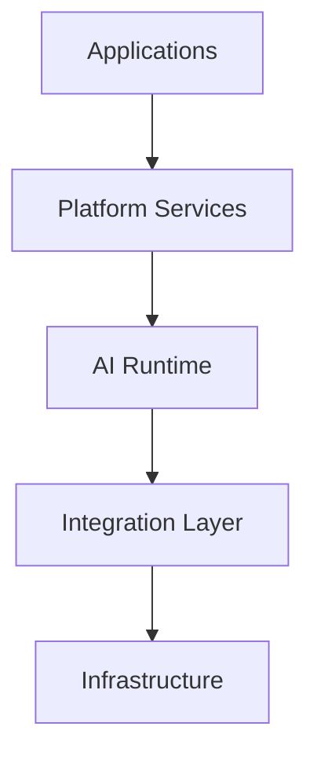

Responsibilities SHALL only flow downward through stable interfaces.

---

# 3. Logical Architecture

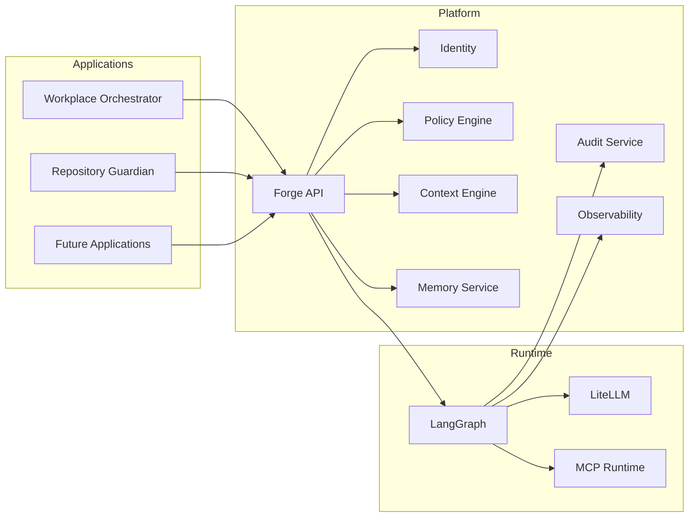

---

# 4. Layer Responsibilities

| Layer | Responsibility |
|--------|----------------|
| Applications | Business capabilities |
| Platform | Governance, identity, policy, context |
| Runtime | AI workflow execution |
| Integration | Model and tool abstraction |
| Infrastructure | Compute, storage, networking |

Applications SHALL NOT bypass platform services.

---

# 5. Component Interaction Model

Every request follows a governed interaction model.

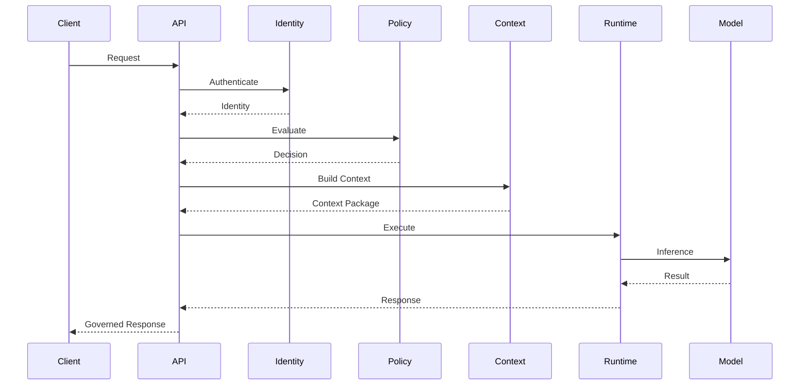

No inference SHALL occur before policy evaluation.

---

# 6. Architectural Characteristics

Forge is intentionally:

- Modular
- Observable
- Replaceable
- Policy-driven
- Deterministic where practical
- Extensible
- Testable
- Cloud-agnostic


# 7. Capability Architecture

Forge is organized around platform capabilities instead of technical products.

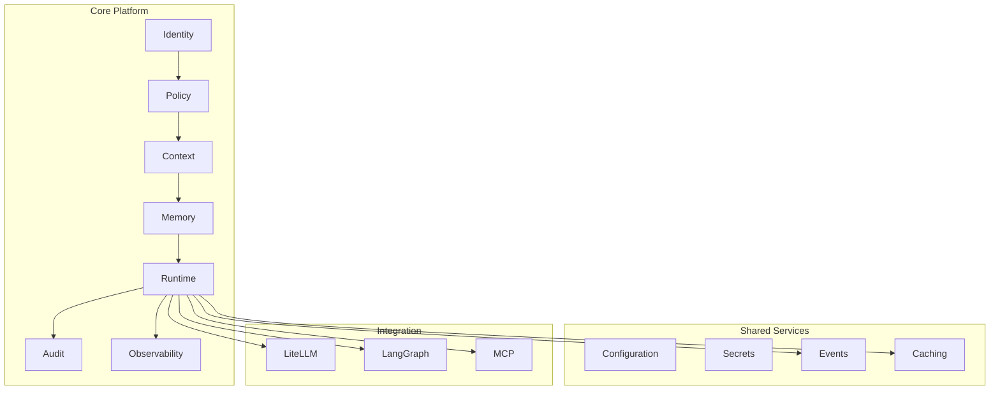

Each capability SHALL expose a stable contract and SHOULD evolve independently.

---

# 8. Internal Service Model

The Forge Platform is intentionally composed of small, focused services.

| Service | Responsibility | State |
|---------|----------------|------|
| Forge API | External entry point | Stateless |
| Identity | Authentication | Stateless |
| Policy Engine | Policy evaluation | Stateless |
| Context Engine | Context construction | Stateless |
| Runtime | Workflow orchestration | Stateless |
| Memory Service | Durable engineering memory | Stateful |
| Audit Service | Evidence collection | Stateful |
| Configuration | Platform configuration | Stateful |

Stateless services SHOULD scale horizontally.

---

# 9. Context Lifecycle

Context is assembled rather than stored as a monolithic prompt.

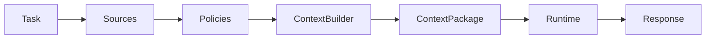

A context package SHOULD contain only the information required for the requested task.

---

# 10. Memory Architecture

Forge distinguishes between execution state and durable knowledge.

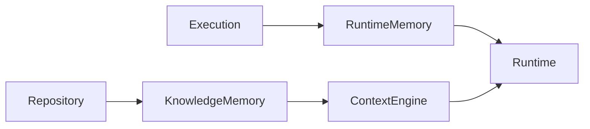

Runtime memory is temporary.

Knowledge memory is durable, version-controlled and reusable.

---

# 11. Policy Execution Flow

Policy evaluation is independent of business logic.

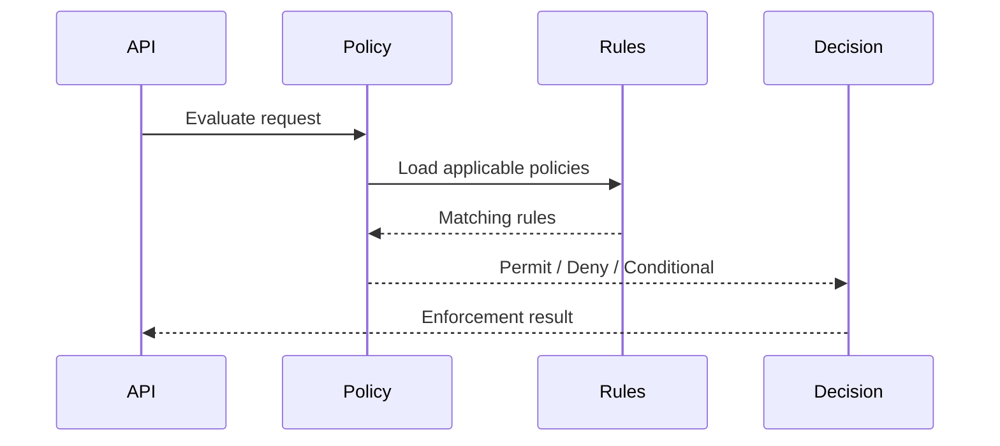

Applications SHALL consume policy decisions instead of implementing authorization logic locally.

---

# 12. Interface Contracts

Every platform capability SHOULD expose interfaces that are:

- Stable
- Versioned
- Observable
- Testable
- Documented
- Backwards compatible where practical

Public APIs SHOULD be described using OpenAPI specifications.

---

# 13. Component Boundaries

The following boundaries SHALL be preserved:

- Applications SHALL NOT directly access AI providers.
- AI providers SHALL be abstracted behind LiteLLM.
- Tools SHALL be accessed through MCP-compatible interfaces.
- Identity SHALL remain independent from Policy.
- Policy SHALL remain independent from Runtime.

These boundaries reduce coupling and simplify future evolution.

---


# 14. Event-Driven Architecture

Forge favors asynchronous communication where it improves resilience, scalability and observability.

Events communicate facts that have already occurred. Commands request work to be performed.

## Design Principles

- Commands SHOULD be explicit.
- Events SHOULD be immutable.
- Consumers SHOULD remain loosely coupled.
- Event producers SHOULD NOT know their consumers.

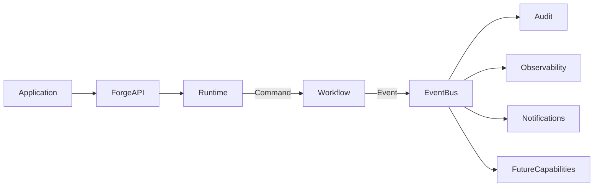

This architecture allows new capabilities to subscribe to platform events without modifying existing services.

---

# 15. Integration Patterns

Forge supports multiple integration patterns depending on the capability.

| Pattern | Typical Use |
|---------|-------------|
| REST | Synchronous APIs |
| MCP | Tool execution |
| Event | Notifications |
| Webhook | External callbacks |
| OpenAPI | Service contracts |

The preferred pattern SHALL minimize coupling while preserving operational simplicity.

---

# 16. Runtime Execution Model

Every execution follows the same logical lifecycle.

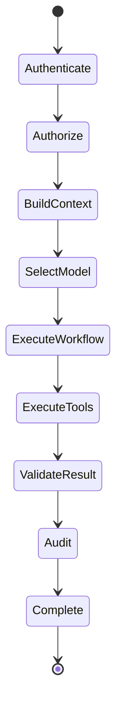

Each state SHOULD emit telemetry.

---

# 17. Error Handling

Errors are expected architectural events.

The platform distinguishes between:

- Validation errors
- Authentication failures
- Authorization failures
- Tool failures
- Provider failures
- Platform failures

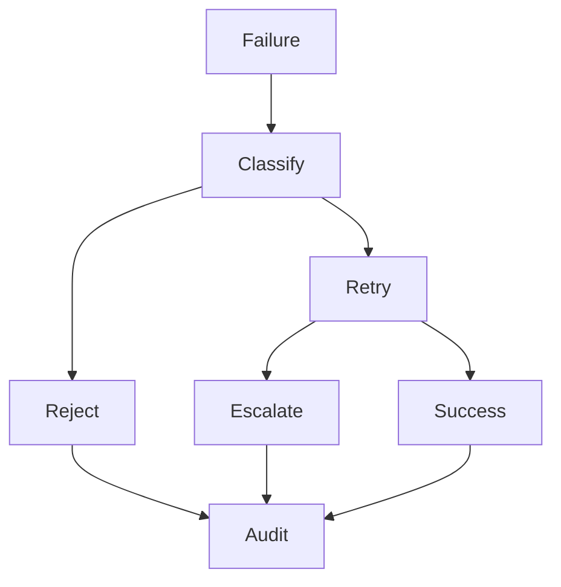

Failures SHALL be observable and auditable.

---

# 18. Resilience Patterns

Forge SHOULD support:

- Timeouts
- Retry with exponential backoff
- Circuit breakers
- Graceful degradation
- Provider failover
- Cached responses where appropriate

Applications SHOULD continue operating whenever safe degradation is possible.

---

# 19. Observability Architecture

Observability is a platform capability.

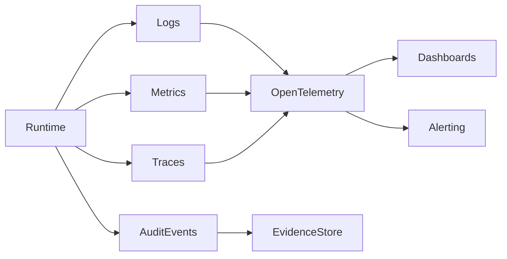

Every significant platform interaction SHOULD produce telemetry.

---

# 20. Extension Model

Forge is extended by adding capabilities rather than modifying the runtime.

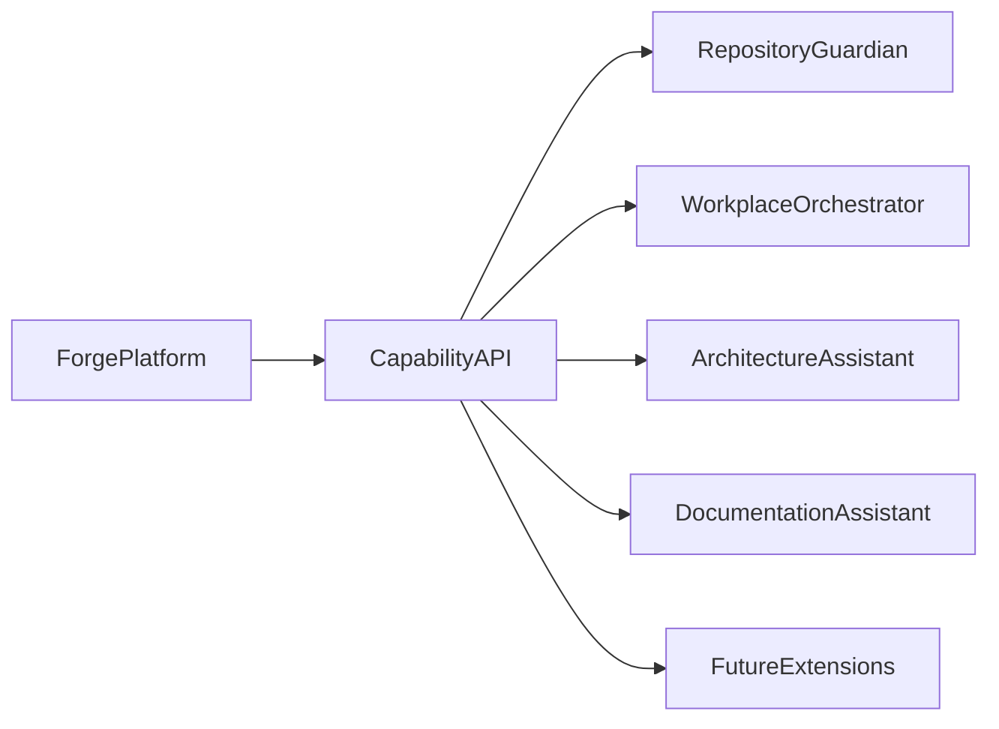

Extensions SHOULD depend on stable capability contracts rather than internal implementation details.

---

# 21. Non-Functional Architecture

The architecture is designed to optimize:

- Reliability
- Scalability
- Security
- Privacy
- Replaceability
- Testability
- Maintainability
- Cost efficiency
- Accessibility

Non-functional requirements SHALL influence architectural decisions from the beginning rather than being added later.

---


# 22. Deployment Architecture

Forge is designed to support multiple deployment models without changing its logical architecture.

Supported deployment patterns include:

- Local development
- Single-node deployment
- High Availability (HA)
- Kubernetes
- Hybrid cloud
- Sovereign cloud

The deployment model SHALL NOT influence application behavior.

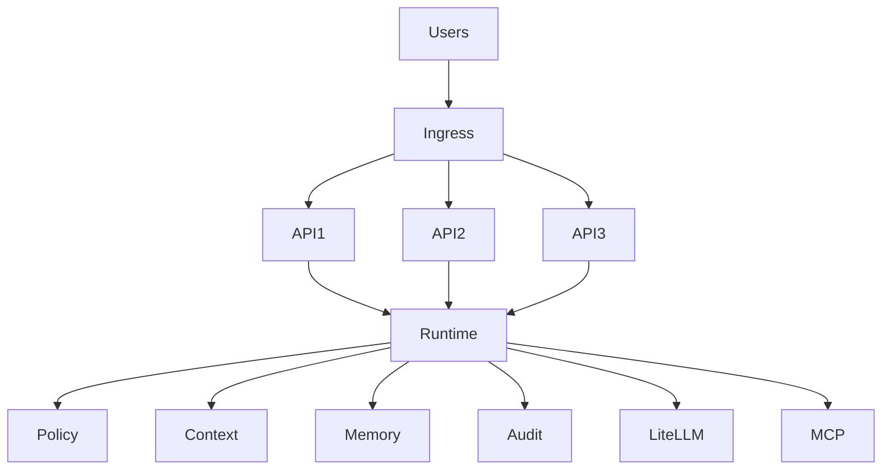

---

# 23. Infrastructure Model

The infrastructure layer provides foundational services required by the platform.

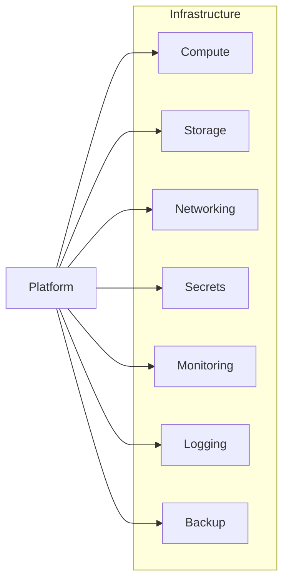

Infrastructure SHALL remain independent from business capabilities.

---

# 24. Data Architecture

Forge distinguishes between operational data and engineering knowledge.

| Data Type | Lifetime | Example |
|-----------|----------|---------|
| Request State | Temporary | Runtime execution |
| Context Package | Temporary | Prompt context |
| Audit Evidence | Long-term | Execution logs |
| Repository Knowledge | Permanent | Markdown, ADRs |
| Configuration | Long-term | Policies, settings |

Knowledge SHALL remain version controlled.

---

# 25. AI Provider Strategy

Forge is intentionally provider-neutral.

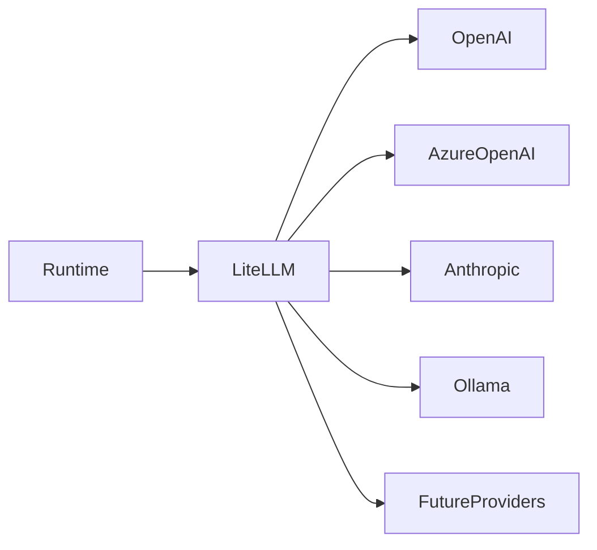

Model selection SHALL be based on:

- capability;
- policy;
- cost;
- latency;
- availability.

Applications SHALL never directly invoke providers.

---

# 26. Security Boundaries

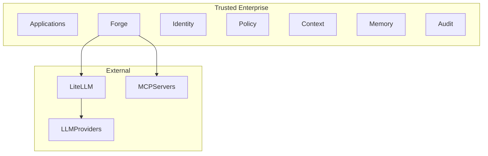

Only the minimum required information SHOULD leave the trusted environment.

---

# 27. Technology Decisions

Technology choices are implementation details rather than architectural requirements.

Preferred technologies today include:

- Go
- React
- LangGraph
- LiteLLM
- MCP
- OpenTelemetry
- OpenAPI
- GitHub
- Kubernetes

Equivalent technologies MAY be substituted provided architectural requirements continue to be satisfied.

---

# 28. Reference Deployment

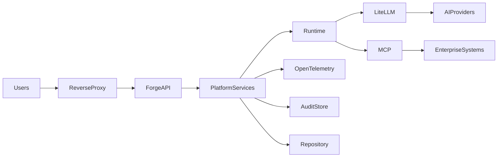

This deployment illustrates the preferred logical separation of concerns.

---


# 22. Deployment Architecture

Forge is designed to support multiple deployment models without changing its logical architecture.

Supported deployment patterns include:

- Local development
- Single-node deployment
- High Availability (HA)
- Kubernetes
- Hybrid cloud
- Sovereign cloud

The deployment model SHALL NOT influence application behavior.


---

# 23. Infrastructure Model

The infrastructure layer provides foundational services required by the platform.


Infrastructure SHALL remain independent from business capabilities.

---

# 24. Data Architecture

Forge distinguishes between operational data and engineering knowledge.

| Data Type | Lifetime | Example |
|-----------|----------|---------|
| Request State | Temporary | Runtime execution |
| Context Package | Temporary | Prompt context |
| Audit Evidence | Long-term | Execution logs |
| Repository Knowledge | Permanent | Markdown, ADRs |
| Configuration | Long-term | Policies, settings |

Knowledge SHALL remain version controlled.

---

# 25. AI Provider Strategy

Forge is intentionally provider-neutral.


Model selection SHALL be based on:

- capability;
- policy;
- cost;
- latency;
- availability.

Applications SHALL never directly invoke providers.

---

# 26. Security Boundaries

```mermaid
flowchart TB

subgraph Trusted Enterprise

Applications
Forge
Identity
Policy
Context
Memory
Audit

end

subgraph External

LiteLLM
LLMProviders
MCPServers

end

Forge --> LiteLLM
Forge --> MCPServers
LiteLLM --> LLMProviders
```

Only the minimum required information SHOULD leave the trusted environment.

---

# 27. Technology Decisions

Technology choices are implementation details rather than architectural requirements.

Preferred technologies today include:

- Go
- React
- LangGraph
- LiteLLM
- MCP
- OpenTelemetry
- OpenAPI
- GitHub
- Kubernetes

Equivalent technologies MAY be substituted provided architectural requirements continue to be satisfied.

---

# 28. Reference Deployment

```mermaid
flowchart LR

Users --> ReverseProxy

ReverseProxy --> ForgeAPI

ForgeAPI --> PlatformServices

PlatformServices --> Runtime

Runtime --> LiteLLM
Runtime --> MCP

LiteLLM --> AIProviders
MCP --> EnterpriseSystems

PlatformServices --> OpenTelemetry
PlatformServices --> AuditStore
PlatformServices --> Repository
```

This deployment illustrates the preferred logical separation of concerns.

---


# 29. Architectural Governance

Architecture is governed as a living engineering discipline rather than a one-time design activity.

All architectural changes SHALL:

- align with the Engineering Constitution;
- be documented through Architecture Decision Records (ADRs);
- preserve platform capabilities;
- maintain backward compatibility where practical;
- include rationale and implementation impact.

Governance exists to preserve architectural integrity while enabling continuous evolution.

---

# 30. Architecture Decision Records (ADR)

Every significant architectural decision SHOULD be captured in an ADR.

## ADR Lifecycle

```mermaid
flowchart LR

Problem --> Analysis
Analysis --> Options
Options --> Decision
Decision --> ADR
ADR --> Implementation
Implementation --> Review
Review --> LessonsLearned
LessonsLearned --> Problem
```

Each ADR SHOULD document:

- Context
- Problem statement
- Alternatives considered
- Decision
- Consequences
- References

---

# 31. Architecture Review Process

Architecture reviews are intended to improve designs rather than approve individuals.

```mermaid
flowchart TD

Proposal
--> TechnicalReview
--> SecurityReview
--> OperationalReview
--> DocumentationReview
--> Approval
--> Implementation
```

Reviews SHOULD focus on:

- architectural consistency;
- maintainability;
- security;
- observability;
- long-term operational impact.

---

# 32. Quality Attributes

The following quality attributes guide architectural evolution.

| Attribute | Goal |
|-----------|------|
| Availability | Minimize downtime |
| Reliability | Predictable execution |
| Security | Protect information assets |
| Maintainability | Reduce engineering effort |
| Extensibility | Support future capabilities |
| Interoperability | Enable standards-based integration |
| Observability | Provide operational insight |
| Performance | Efficient execution |
| Cost Efficiency | Optimize resource usage |

Trade-offs SHALL be documented through ADRs.

---

# 33. Architecture Checklist

Before implementation, engineers SHOULD verify:

- [ ] Does the change align with the Constitution?
- [ ] Does it preserve platform boundaries?
- [ ] Are interfaces documented?
- [ ] Is the solution observable?
- [ ] Is the solution testable?
- [ ] Has security been considered?
- [ ] Has privacy been considered?
- [ ] Is the change economically justified?
- [ ] Are documentation updates included?
- [ ] Is an ADR required?

---

# 34. Evolution Strategy

Forge evolves through incremental improvement.

Preferred evolution principles include:

- Small changes over large rewrites.
- Stable interfaces over breaking changes.
- Reusable capabilities over duplicated implementations.
- Explicit documentation over implicit knowledge.
- Measured improvements over speculative optimization.

Architecture SHALL remain understandable by new contributors.

---

# 35. Reference Architecture Summary

```mermaid
flowchart TB

subgraph Consumers
Applications
end

subgraph Forge
API
Identity
Policy
Context
Memory
Runtime
Audit
Observability
end

subgraph Integration
LangGraph
LiteLLM
MCP
end

subgraph External
AIProviders
EnterpriseSystems
end

Applications --> API
API --> Identity
Identity --> Policy
Policy --> Context
Context --> Memory
Memory --> Runtime
Runtime --> Audit
Runtime --> Observability

Runtime --> LangGraph
LangGraph --> LiteLLM
LangGraph --> MCP

LiteLLM --> AIProviders
MCP --> EnterpriseSystems
```

The reference architecture intentionally separates enterprise governance from AI execution, enabling applications to remain focused on business capabilities while the platform provides reusable services.

---

# 36. Conclusion

Forge is designed to be:

- Governed rather than improvised.
- Capability-driven rather than vendor-driven.
- Observable rather than opaque.
- Evolvable rather than static.
- Reusable rather than application-specific.

This document serves as the normative architectural reference for all subsequent implementation guidance.

Related documents:

- CONTEXT_ENGINEERING.md
- MEMORY_MODEL.md
- POLICY_MODEL.md
- SECURITY_MODEL.md
- TOOL_MODEL.md
- GOVERNANCE_MODEL.md

_End of ARCHITECTURE.md_


