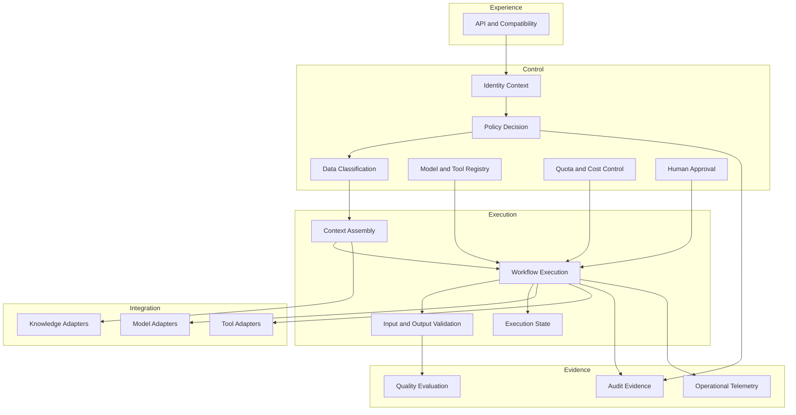

# Reference Architecture

This document defines the proposed logical boundaries of Forge. Technology selection, deployment topology, and implementation sequencing require separate decisions.

## Goals

- enforce governance before consequential execution;
- keep product behavior outside reusable platform capabilities;
- minimize data disclosure and external side effects;
- support replaceable providers and protocols;
- produce end-to-end decision and execution evidence;
- scale and recover according to measurable service objectives;
- avoid premature distributed-system complexity.

## Boundary rules

1. Applications enter through stable experience contracts.
2. Authentication establishes identity; policy decides authorization.
3. Policy is evaluated before context disclosure, model calls, and tool side effects.
4. Execution consumes decisions but does not define governance policy.
5. Integration adapters do not receive unrestricted authority.
6. Audit records include denials, failures, approvals, and version provenance.
7. Stateful capabilities declare data ownership, consistency, retention, and recovery.
8. Logical modules remain independently testable even when deployed together.

## Logical capabilities

## Execution envelope

Every governed execution should have a versioned envelope containing at least:

- tenant or organizational boundary;
- authenticated principal and delegated identity;
- declared purpose and requested capability;
- data classification and handling constraints;
- policy and configuration versions;
- context sources and digest;
- eligible model and tool set;
- time, cost, and token budgets;
- correlation and idempotency identifiers;
- approval state and expiry;
- retention and evidence requirements.

The envelope is a contract, not a prompt.

## State ownership

| State | Intended owner | Required definition |
|---|---|---|
| Identity session | Identity capability | expiry, revocation, delegation |
| Policy data | Governance capability | versioning, distribution, rollback |
| Execution checkpoint | Execution capability | consistency, cancellation, recovery |
| Durable knowledge | Knowledge capability | provenance, retention, access control |
| Audit evidence | Evidence capability | integrity, retention, legal access |
| Telemetry | Operations capability | sampling, redaction, retention |

## Scalability and resilience

The architecture does not assume horizontal scalability merely because a component is called stateless. Each capability must define:

- service objectives and capacity assumptions;
- concurrency and backpressure behavior;
- timeout, retry, circuit-breaker, and idempotency semantics;
- degradation behavior when a dependency is unavailable;
- recovery point and recovery time objectives;
- tenant isolation and noisy-neighbor controls.

Asynchronous execution is preferred for long-running or approval-bound work. Synchronous execution must have bounded duration and resource budgets.

## Change control

An ADR is required for:

- deployment-unit extraction;
- adoption of a mandatory provider or protocol;
- changes to trust or data boundaries;
- state ownership or persistence changes;
- externally visible contract changes;
- exceptions to governance or audit requirements.
