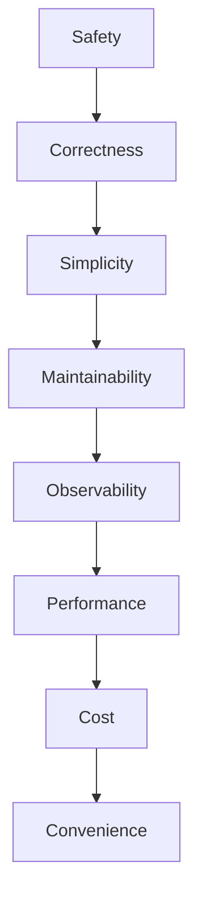
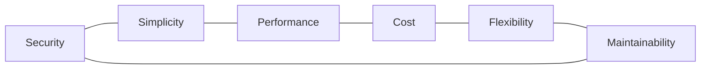

# Engineering Intent

> This document explains the engineering intent behind Forge. It defines the objectives that guide architectural decisions, implementation priorities and long-term platform evolution.

## Purpose

Architecture describes **what** the platform looks like.

The Constitution defines **what must never change**.

Engineering Intent explains **why engineering decisions are made** and how competing priorities should be balanced.

---

# 1. Mission

Forge exists to make enterprise AI engineering predictable, governed and maintainable.

The platform is designed to help organizations build AI solutions that can be trusted over years rather than demonstrations that work for days.

---

# 2. Desired Outcomes

Engineering decisions SHOULD improve one or more of the following outcomes:

- Trustworthiness
- Maintainability
- Reproducibility
- Security
- Privacy
- Operational simplicity
- Cost efficiency
- Developer productivity
- Architectural consistency

If a change improves only one dimension while significantly degrading several others, it SHOULD be reconsidered.

---

# 3. Engineering Priorities

When trade-offs are required, Forge generally prioritizes:

1. Safety
2. Correctness
3. Simplicity
4. Maintainability
5. Observability
6. Performance
7. Cost optimization
8. Convenience

These priorities are intentionally conservative for enterprise environments.

---

# 4. Decision Framework

Major engineering decisions SHOULD be evaluated against a common framework.

| Question | Intent |
|----------|--------|
| Is it secure? | Protect users and data |
| Is it understandable? | Reduce cognitive load |
| Is it observable? | Enable operations |
| Is it testable? | Improve confidence |
| Is it replaceable? | Reduce vendor lock-in |
| Is it economical? | Optimize total cost |

Architecture Decision Records (ADRs) SHOULD document significant deviations.

---

# 5. Trade-off Philosophy

Engineering is the process of balancing constraints rather than maximizing a single metric.

The preferred solution is the one that delivers the best overall balance for long-term operation.

---

# 6. Success Criteria

Forge is successful when:

- New capabilities integrate without architectural redesign.
- AI providers can be replaced with minimal effort.
- Policies remain independent from applications.
- Documentation stays synchronized with implementation.
- Engineers understand the platform without tribal knowledge.
- Operational teams can observe and audit every execution.

---

# 7. Anti-Goals

Forge intentionally avoids:

- Framework lock-in
- Hidden architectural decisions
- Business logic inside prompts
- AI-first design without governance
- Vendor-specific platform assumptions
- Duplicate implementations of platform capabilities

---

# 8. Continuous Improvement

Forge evolves through small, evidence-based iterations.

Every iteration SHOULD improve at least one of the following:

- Architecture
- Documentation
- Automation
- Quality
- Security
- Developer experience
- Operational excellence

Large rewrites SHOULD be avoided unless they significantly reduce long-term complexity.

---

# 9. Engineering Mindset

Forge promotes engineering discipline over experimentation.

Innovation is encouraged, but production systems require:

- evidence;
- review;
- testing;
- documentation;
- accountability.

Engineering excellence is achieved through many small, deliberate improvements rather than occasional large changes.

---

# Preview

The next document, **SYSTEM_OVERVIEW.md**, introduces the complete reference architecture of Forge, including capability maps, runtime interactions, trust boundaries and high-level deployment views using Mermaid diagrams.

_End of ENGINEERING_INTENT.md_
