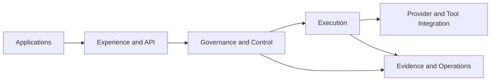
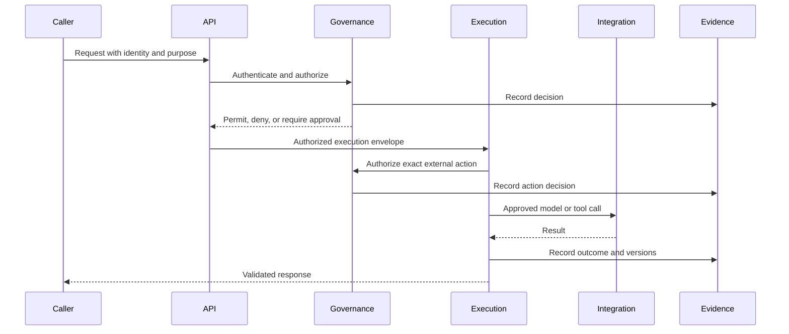

# System Overview

Forge is a proposed shared foundation for governed AI-enabled applications. It separates application behavior from reusable governance and execution capabilities.

This document describes a target model. It makes no implementation or production-readiness claim.

## Architectural model

## Planes

| Plane | Responsibility |
|---|---|
| Experience and API | Stable entry contracts, request normalization, compatibility |
| Governance and Control | Identity context, authorization, policy, classification, budgets, approvals |
| Execution | Context assembly, planning, execution, validation, transient workflow state |
| Integration | Replaceable model, data, and tool adapters |
| Evidence and Operations | Audit, telemetry, evaluation, cost, reliability, incident evidence |

Planes are logical boundaries. They are not automatically separate deployment units.

## Governed lifecycle

Denied, failed, cancelled, and approved paths are first-class outcomes.

## Trust boundaries

- Callers are untrusted until authenticated.
- Model providers, tool endpoints, retrieved content, and generated output are untrusted inputs.
- Integration adapters are not authorization boundaries.
- Evidence storage must resist unauthorized modification.
- Data may cross a boundary only when purpose, classification, policy, and provider eligibility permit it.

## Architectural posture

Forge starts as a modular system with explicit internal contracts. Distribution requires an ADR supported by measurable needs such as independent scaling, isolation, ownership, or availability.
